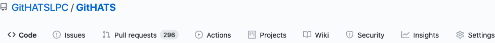
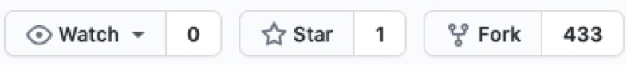
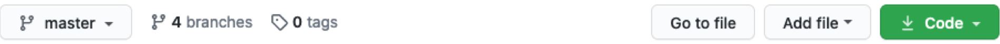
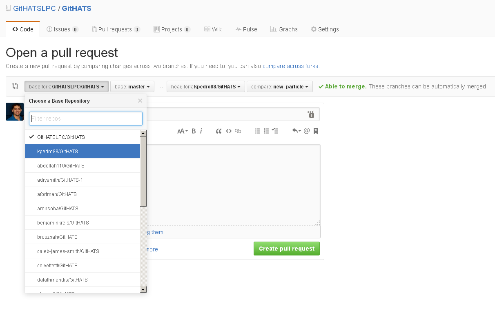
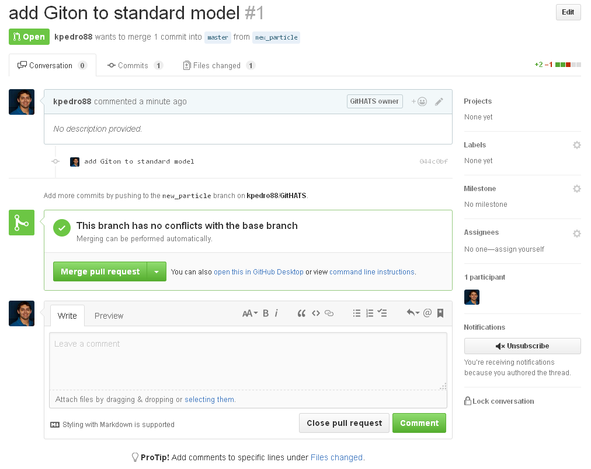



## Introduction
This exercise walks you through the standard GitHub "fork and pull" workflow: copy a repository, make a change, and propose it back as a pull request.
It is a condensed version of the [CMSGitTutorial](https://twiki.cern.ch/twiki/bin/view/CMS/CMSGitTutorial). If you've never used git or other version control, read at least the first set of its [slides](https://twiki.cern.ch/twiki/bin/view/CMS/CMSGitTutorial#Accompanying_slides) first.

> ## Prerequisite
> You need a [GitHub] account with SSH keys set up, as described in the [setup instructions][lesson-setup].
> Choose your username wisely: it appears on all your contributions to CMS code. If yours is something like `edgelord1337`, consider changing it or making a second account.
{: .prereq}

## Configure git
Tell git who you are. Do this on every computer you develop on (cmslpc, your laptop, ...), replacing the `[brackets]` with your details and GitHub username:

```shell
git config --global user.name "[Name]"
git config --global user.email [Email]
git config --global user.github [Account]
```
{: .source}

Check the result with `cat ~/.gitconfig`; it should contain a `[user]` section with these three values.

> ## Optional settings
> ```shell
> # Your preferred editor for commit messages
> git config --global core.editor [your preferred text editor]
> # Make `git push origin` push the current branch
> git config --global push.default current
> # `git lol`: a compact, graphical log
> git config --global alias.lol 'log --graph --decorate --pretty=oneline --abbrev-commit'
> # Shortcuts such as `git clone github:GitHATSLPC/GitHATS.git`
> git config --global url."git@github.com:".insteadOf github:
> git config --global url."ssh://git@gitlab.cern.ch:7999/".insteadOf gitlab:
> ```
> {: .source}
{: .callout}

## The GitHub interface
Open the [GitHATSLPC/GitHATS](https://github.com/GitHATSLPC/GitHATS) repository and click around:

- Top left: Code, Issues, Pull Requests, Actions, Projects, Wiki, Security, Insights

- Top right: Notifications, Star, Fork

- On the Code page: commits, branches, releases, contributors


## Fork and clone
Click **Fork** (top right) on [GitHATSLPC/GitHATS](https://github.com/GitHATSLPC/GitHATS) to make your own copy under your GitHub account.
Then clone your fork, on cmslpc or your laptop, and look around:

```shell
mkdir scratch
cd scratch
git clone git@github.com:[user]/GitHATS.git
cd GitHATS
ls -a
git branch -a
```
{: .source}

> ## Expected output
> `ls -a` shows the files plus a `.git` folder, which holds the full history of the repository:
> ```
> .  ..  .git  README.md  standard_model.md
> ```
> `git branch -a` shows you are on `main`, the repository's default branch, plus the branches on GitHub:
> ```
> * main
>   remotes/origin/HEAD -> origin/main
>   remotes/origin/atlas_discovery
>   remotes/origin/cms_discovery
>   remotes/origin/dune_discovery
>   remotes/origin/main
> ```
{: .solution}

## Remotes and synchronizing
A **remote** is a copy of the repository elsewhere. `git clone` creates one called `origin`, pointing to your fork.
Add a second remote, traditionally called `upstream`, pointing to the original repository:

```shell
git remote add upstream git@github.com:GitHATSLPC/GitHATS.git
git remote -v
```
{: .source}

> ## Expected output
> ```
> origin    git@github.com:[user]/GitHATS.git (fetch)
> origin    git@github.com:[user]/GitHATS.git (push)
> upstream  git@github.com:GitHATSLPC/GitHATS.git (fetch)
> upstream  git@github.com:GitHATSLPC/GitHATS.git (push)
> ```
{: .solution}

Before making changes, bring your copy up to date with `upstream` (someone may have changed it), and push any updates to your fork. Here, both will just report that everything is up to date.

```shell
git pull upstream main    # same as: git fetch upstream main; git merge upstream/main
git push origin main
```
{: .source}

## Make and commit a change
Make your changes on a separate **topic branch**. This keeps `main` in sync with upstream and lets you work on several changes at once.

```shell
git checkout -b MyBranch
```
{: .source}

Edit `standard_model.md` and add a row for a new particle, the Giton: symbol G, spin 2, charge 0, mass 750 GeV.
(Any resemblance to real or imaginary particles is entirely coincidental.)

Look at what changed:

```shell
git status      # which files changed
git diff        # what changed in them
```
{: .source}

> ## Expected output
> `git status` lists `modified:   standard_model.md` under "Changes not staged for commit". `git diff` shows your new line with a `+`:
> ```
> +| Giton         | G      | 2    | 0       | 750                     |
> ```
{: .solution}

**Stage** the change (choose what goes into the next commit), **commit** it to your local repository, and **push** the branch to your fork:

```shell
git add standard_model.md
git commit -m "add Giton to standard model"
git push origin MyBranch
```
{: .source}

> ## Expected output
> The push ends with a link for opening a pull request:
> ```
> remote: Create a pull request for 'MyBranch' on GitHub by visiting:
> remote:      https://github.com/[user]/GitHATS/pull/new/MyBranch
> ...
>  * [new branch]      MyBranch -> MyBranch
> ```
{: .solution}

## Make a pull request
A **pull request** (PR) proposes your change for inclusion in another repository.
Open the link printed by `git push` (or your fork's page on GitHub). You can send a PR to any fork and branch of the repository:


Send it to the `main` branch of the upstream repository (GitHATSLPC):


> ## Question 4.1
> Enter the link to your pull request in the answer form.
{: .challenge}

> ## Optional: go further
> - To practice merging, send a pull request from `MyBranch` to your *own* fork's `main` branch and merge it.
> - Not covered here: rebasing, cherry-picking, undoing changes, and CMSSW-specific git usage. Learn more from the [CMSGitTutorial](https://twiki.cern.ch/twiki/bin/view/CMS/CMSGitTutorial), the [HSF training modules](https://hsf-training.org/training-center/), and the [Pro Git book](https://git-scm.com/book/en/v2).
{: .callout}


